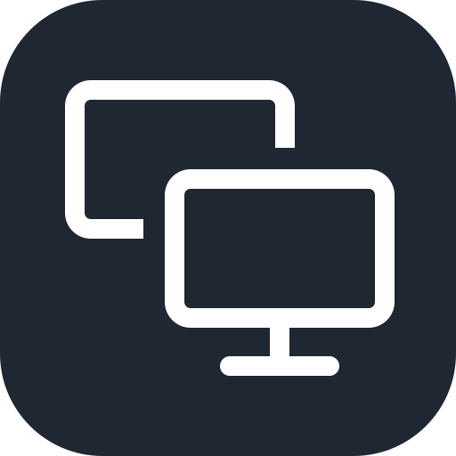

  

# HDMI Defubar

A macOS menubar app that fixes the "my Mac forgot my monitor layout again" problem
for external displays, typically those connected over HDMI.

## The problem

macOS remembers display configurations (resolution, scaling, refresh rate and
arrangement) keyed by a display UUID derived from the monitor's EDID. Some
monitors, especially over HDMI or through adapters, docks and KVMs, don't expose
a usable serial number in their EDID. In that case macOS generates a *random*
UUID every time the monitor connects. Each plug-in then looks like a brand-new,
never-seen display: the saved configuration is ignored, a default one is
created and you have to redo resolution and arrangement by hand. With multiple
externals this gets old fast.

The tell: `~/Library/Preferences/ByHost/com.apple.windowserver.displays.*.plist`
accumulates hundreds of stored configs referencing display UUIDs that each
appear only once or twice.

## The workaround

Even when the UUID churns, CoreGraphics still reports a stable hardware identity
for the monitor: vendor number, model number and (usually) serial number.
hdmi-defubar keys layouts on that fingerprint instead of the UUID:

1. It watches for display reconfiguration events.
2. When you arrange your displays by hand, it learns that layout for the current
   *set* of connected monitors (laptop alone, laptop plus one external, laptop
   plus two, ... each set gets its own layout).
3. When a monitor reconnects and macOS assigns it a fresh ID with a default
   config, hdmi-defubar recognizes the physical monitor by fingerprint,
   reapplies your saved resolution, refresh rate, scaling and arrangement in one
   transaction and posts a notification saying it did so.

The result: everything just looks normal, plus a notification telling you the
issue was detected and fixed.

## How it works

- **Display watcher.** Registers a CoreGraphics display reconfiguration
  callback and debounces the event bursts that happen during connect and
  disconnect. Events are classified as topology changes (display added or
  removed) or in-place changes (same displays, new mode or arrangement).
- **Fingerprinting.** Each display is identified by vendor + serial, with the
  model number used only when no serial is exposed. Model is deliberately
  excluded when a serial exists: some monitors (Samsung Odyssey G7 family)
  report a different EDID product id across reconnects. A layout is keyed by
  the sorted set of fingerprints currently online.
- **Restorer.** After a topology change settles, the saved layout for the
  current monitor set is diffed against reality and applied atomically via
  `CGBeginDisplayConfiguration` / `CGCompleteDisplayConfiguration`. One attempt
  per connect event, never a retry loop. If the exact saved mode isn't offered
  (the same monitor can expose different mode lists per port), the closest mode
  with the same point size is used and the notification says so.
- **Learner.** After an in-place change that wasn't caused by the app itself,
  the new state is snapshotted once it has been stable for a few seconds and a
  notification confirms what was learned. The last arrangement you made by
  hand always wins. A "Save current layout" menu item exists as an explicit
  override.
- **Mode inheritance.** A never-seen *combination* of known monitors is not
  left at macOS defaults: each display's resolution and refresh rate are
  borrowed from the layouts it appears in (preferring the layout sharing the
  most displays with the current set) and applied, while the arrangement is
  left to macOS. Nothing is saved until you arrange the combination once.
- **Menubar UI.** Shows connected monitors, whether a saved layout matched and
  the last action taken. Actions: save current layout, restore now,
  pause/resume automatic handling and launch at login. A "Manage layouts"
  window lists saved layouts under readable names ("MacBook + LG HDR 4K",
  renamable to things like "Home desk") with an arrangement thumbnail per
  layout, a connected-now badge and restore/delete actions.
- **Storage.** Layouts live in a JSON file under
  `~/Library/Application Support/hdmi-defubar/`, written atomically.
- **Logging.** All decisions (event classification, fingerprints, diffs, chosen
  modes, apply results) go to the unified log; interventions and errors also
  surface as user notifications.

## Out of scope

- Rotation (requires private APIs), mirroring and per-app window placement.
- Root-cause EDID fixes: EDID overrides are largely ignored on Apple Silicon,
  which is why this works around the identity problem instead.

## Limitations

- The hardware fingerprint carries all identity weight: two identical monitors
  that both lack an EDID serial cannot be told apart reliably.
- If macOS restores the correct layout on its own, the app does nothing; it
  only intervenes on mismatch.

## Building

Requires Xcode command line tools on macOS 13 or later.

    swift test          # run the unit tests
    Scripts/make-app.sh # build "build/HDMI Defubar.app"
    cp -R "build/HDMI Defubar.app" /Applications/

The app lives only in the menubar (no dock icon). Launch it once from
/Applications, grant the notification permission and enable "Launch at
login" from its menu. `hdmi-defubar --dump` prints the current displays,
fingerprints and the matched saved layout as JSON for debugging. See
[docs/manual-testing.md](docs/manual-testing.md) for the manual test
procedure.

## Requirements

- macOS 13 or later (SwiftUI `MenuBarExtra`), Apple Silicon or Intel.
